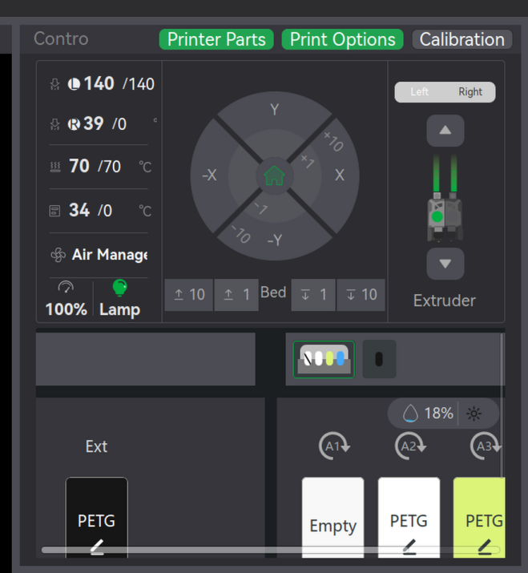

# Original AMS overflow evidence for PR #13

The previous before image already included an earlier AMS workaround and did not show the original failure. This correction uses the original user report, with horizontal and vertical scrollbars and content cut off on the right and bottom.

The existing after image shows the complete external spool, A1–A4, routing and Auto-refill/Unload/Load controls, without internal scrollbars.

These are historical captures at different sizes and times. The after image comes from the combined Linux fixes, not an isolated PR #13 build. The original PNG is unchanged; the after image is reused unchanged from its existing immutable URL. [Hashes and provenance](manifest.json).

No application code, PR source head, installed application, GUI or printer state changed.
